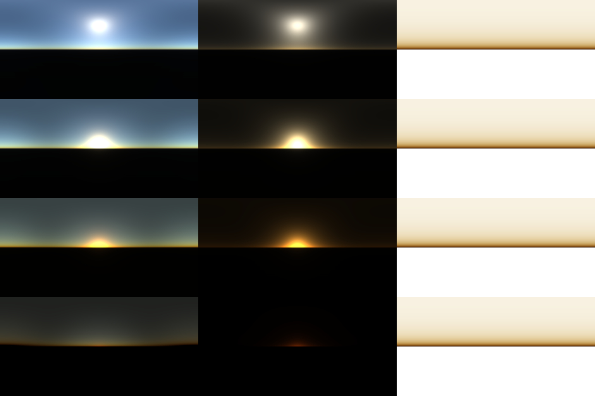

# EZ Atmos Scatter

Physically based atmospheric scattering for The Foundry Nuke, built in BlinkScript.

EZ Atmos Scatter takes a lat-long HDRI and a sun direction (found in the HDRI, or driven by
an Axis node) and generates atmospheric scattering passes as AOV layers that can be
composited on top of the source HDRI.

Target: Nuke 15.1.

## Status

Step 2 of 4: the EzAtmosScatter gizmo, lit by the HDRI (automatic sun detection, sun colour
and brightness from the image, sky light). Depth-aware haze and multiple scattering come next.

## Contents

| Path | What it is |
| --- | --- |
| `gizmos/EzAtmosScatter.gizmo` | The node artists use. Built from the kernels by `python/build_gizmo.py` |
| `blink/AtmosScatter.blink` | BlinkScript kernel: Rayleigh + Mie single scattering per lat-long pixel |
| `blink/EzAtmosLight.blink` | BlinkScript kernel: measures the sun and sky light in the HDRI |
| `blink/EzAtmosDome.blink`, `blink/EzAtmosDomeUV.blink`, `blink/EzAtmosCameraUV.blink` | BlinkScript kernels: skydome texture to lat-long and back, and lat-long to the camera view (for *output as* Skydome and Camera) |
| `blink/EzAtmosTransmittanceLUT.blink` | BlinkScript kernel: precomputes the optical depth towards the sun as a 256x64 table |
| `python/build_gizmo.py` | Rebuilds the gizmo after a kernel change |
| `init.py`, `menu.py` | Plugin path and the Nodes menu entry |
| `reference/atmos_reference.py` | NumPy port of the scattering core for checking the math outside Nuke |
| `docs/previews/contact_sheet.png` | Reference renders: inscatter, Mie and transmittance at 45°, 10°, 2° and -2° sun elevation |



## Guide

The illustrated artist guide to EzAtmosScatter and EzDepthHaze lives in the EzDepthHaze repo:
[EZ_Haze_Field_Guide.pdf](https://github.com/calcipher89/EzDepthHaze/blob/main/docs/EZ_Haze_Field_Guide.pdf).
Its demo scene is built by `examples/build_demo.py` there.

## Installing

No install: `groups/EzAtmosScatter_group.nk` is the same node as a plain Group. Import it with
**File > Import Script** (or paste its text into the node graph) and it works on its own,
without the gizmo on the plugin path, so it can live in a shot script or a toolset.

As a gizmo:

Clone the repo into `~/.nuke/plugins/EzAtmosScatter` and add this line to `~/.nuke/init.py`:

```python
nuke.pluginAddPath('./plugins/EzAtmosScatter')
```

The node then shows up under **Nodes > EzAtmosScatter**.

## Using it

1. Read in a lat-long HDRI and connect it to the `hdri` input.
2. Leave **sun from** on *Auto (HDRI)*, or plug an Axis into the `sun` input and set it to
   *Axis* (the sun is in the direction of the Axis's world position), or type a direction
   in *Manual*.
3. Pick what the main rgba shows with **view output**. Every pass is also written to its
   own layer, whatever the view output is:

| Layer | Contents |
| --- | --- |
| `atmos_inscatter` | Light scattered towards the camera (sky + haze + sky light) |
| `atmos_rayleigh` | Sky only (blue sky) |
| `atmos_mie` | Haze only (haze and glow around the sun) |
| `atmos_ambient` | Sky light: the whole HDRI sky scattered into the haze |
| `atmos_transmittance` | How much of the background survives along each view ray |
| `atmos_haze_color` | Depth haze colour: what infinitely deep haze looks like in each direction (see Depth haze below) |
| `atmos_haze_sun` | The sunlit part of `atmos_haze_color`: what shadowed haze loses |
| `atmos_haze_sky` | The sky-lit part of `atmos_haze_color`: what shadowed haze keeps |

The Scatter Preview Comp is `hdri * atmos_transmittance + atmos_inscatter`.

### Knobs

| Knob | Default | What it does |
| --- | --- | --- |
| view output | Scatter Preview Comp | What the main rgba shows |
| passes | Depth Haze | *Atmosphere*: rays run through the whole sky down to the ground. *Depth Haze*: every pass describes the haze around the camera out to *haze distance*, with no ground and no horizon line |
| output as | Lat-long | *Skydome* lays every layer out as the texture of the dome in the `dome` input, so it goes back on the same Sphere. *Camera* gives every layer as the shot camera sees it, at the project format: the sky plate a ScanlineRender of the skydome would give (see Skydome below) |
| sun from | Auto (HDRI) | Where the sun direction comes from: the HDRI, the Axis input or the manual knob |
| sun direction | (0, 0.5, -1) | Manual sun direction, +Y up |
| copy detected sun to manual | | Writes the sun found in the HDRI into *sun direction* |
| reset sun | | Puts the sun back to its defaults: *sun from* Auto (HDRI), *sun direction* (0, 0.5, -1) |
| sun in use | read only | The sun direction the node is using, whichever *sun from* is set. EzDepthHaze follows this one |
| hdri rotation | 0 | Rotates the lat-long mapping, in degrees |
| self-lit (no HDRI) | off | For setups without an HDRI: sky light comes from this atmosphere's own sky, and the sun from *sun color* and *sun strength*. Replaces a second EzAtmosScatter used only as a sky. The hdri input can then be left empty: a black 2048x1024 lat-long stands in |
| light from HDRI | on | Sun colour and brightness come from the HDRI. Off: *sun color* and *sun strength* set them |
| sun color | white | Tint on the HDRI's sun, or the sun colour when *light from HDRI* is off |
| sun strength | 1 | Multiplies the sun's brightness |
| sun boost | 1 | Only for clipped suns (JPEGs, LDR captures); scales the brightness estimated from the sky |
| sky light | 1 | How much of the HDRI sky lights the haze |
| sky amount | 1 | Air density (Rayleigh) |
| haze amount | 1 | Haze density (Mie) |
| haze glow size | 1 | Size of the glow around the sun |
| camera height (m) | 1 | Camera height above sea level |
| max distance (km) | 0 (off) | How far the haze reaches. Use it to add haze up to a set distance instead of a full sky |
| haze height (km) | 1.2 | How quickly the haze thins with altitude (its scale height). Low keeps it near the ground |
| haze density (1/m) | read only | Extinction per metre at camera height, for depth hazing in a comp |
| haze distance (km) | 5 | How far the depth haze reaches, for the *Haze Preview* view and the *Depth Haze* passes. *analyze* sets it to the distance of the horizon |
| quality | Normal | Samples per ray (Draft is about 4x faster than High) |
| downscale | Full | Shrinks the HDRI to 1024 (*1K*) or 512 (*0.5K*) wide as it comes in, works at that size, and scales every layer back up to the HDRI format at the end |
| viewer resolution | Half | Resolution the haze is computed at in the Nuke GUI (Full / Half / Quarter) |
| render resolution | Full | Resolution the haze is computed at in terminal and farm renders |

The **Advanced** section holds the physical constants (scattering coefficients, scale
heights, planet size) and the sun detection settings.

### Analyze

Connect the HDRI, the shot camera (and the skydome, if there is one), set **units to
metres** (0.1 for a decimetre scene) and **ground height** (in scene units), and press
**analyze**. It sets the node up for depth hazing that shot and tells you what it set. If
*units to metres* is still 1, it first asks once which units the scene is in (Metres,
Decimetres, Centimetres, Millimetres, Feet or Inches, each with the camera height it would
give), since nothing in the scene says so:

- *passes*: Depth Haze;
- *camera height*: the camera's height above the ground, in metres;
- *haze distance*: the distance to the HDRI's own horizon line, from how far below level it
  sits in the image, so the depth haze reaches the line the HDRI shows; without a clear
  line, the distance to the horizon from the camera height (46 km from 166 m, 234 km
  from 4.3 km);
- *self-lit* with no HDRI; with one, *sun from* Auto when the HDRI has a clear (or
  clipped) sun.

It also warns when the sun is beside or behind the camera or high in the sky, which the
sunrise and golden hour looks don't expect. The camera, sun Axis and dome can come through
Dots and NoOps.

### Depth haze

The *Haze Color* view (and the `atmos_haze_color` layer) is the colour fog settles to when it is
infinitely deep, for every direction around the camera. It combines sunlight scattered
by the air and haze at camera height, strongest near the sun because haze scatters
mostly forwards, with the HDRI sky light scattered evenly. It has no ground and no
horizon line, so it can haze a plate with any metric depth pass:

```
T      = exp(-haze_density * depth_in_metres)
result = plate * T + hazeColor * (1 - T)
```

In a comp, an Expression node can read *haze density* from the gizmo
(`EzAtmosScatter1.haze_density.r` and so on), and `hazeColor` comes from a lat-long lookup
of `atmos_haze_color` along each pixel's view direction.

*Haze Preview* shows the result on the preview comp as if everything were *haze
distance* away. Setting **passes** to *Depth Haze* gives every layer (Scatter, Sky, Haze,
Sky Light, Transmittance) in that form, so they composite the same way as the atmosphere
passes: `plate * atmos_transmittance + atmos_inscatter`. There the haze also thins with height: along a ray at elevation
cos = dir.y each part of the atmosphere adds `beta(h0) * H * (1 - exp(-d * cos / H)) / cos`
of optical depth (scale height H), so looking up clears faster than looking sideways.
A low *haze height* with a high *haze amount* gives a fog bank sitting on the ground.

### How the HDRI lights it

`EzAtmosLight.blink` looks at a 512x256 copy of the HDRI. It finds the brightest spot above
the horizon, treats everything within 6° of it as the sun, and averages the rest of the
upper hemisphere as the sky.

- **Unclipped sun** (a real HDR capture): the sun's irradiance is measured from the image
  and divided by the atmosphere's transmittance towards the sun, so the scattering uses
  the light arriving at the top of the atmosphere.
- **Clipped sun** (its peak is under 20x the average sky): the energy is gone, so the sun
  is sized from the sky brightness instead, using the ratio this model has on a clear day.
  *sun boost* scales that estimate.

Lat-long convention: the centre column looks down -Z, the top row is straight up.

### Skydome

When the HDRI is shown on a skydome in the comp (a Sphere, often under TransformGeos,
rendered with ScanlineRender), plug the dome geometry into the **dome** input and the shot
camera into **camera**. The node follows the chain from the dome input up to the Sphere,
TransformGeos with their axis inputs included, and combines every transform at the frame
being rendered. It then rebuilds the HDRI as seen from the camera: for each direction, where
the ray from the camera hits the moved, rotated or squashed dome, using the Sphere's own
UV mapping. The light, sun and haze then line up with the dome in the comp, and follow it
when it is animated. Without a camera the dome's centre is used. *hdri rotation* still
adds on top, so leave it at 0. Moving the dome marks a bake out of date.

Checked against a ScanlineRender of a dome rotated, moved and scaled in Y twice (Sphere
and TransformGeo) and seen from an offset camera: the HDRI lands within one pixel at 2K.

Set **output as** to *Skydome* to get every layer back as the dome's own texture instead of a
lat-long around the camera: each texel is the atmosphere seen from the camera towards that
point of the moved, rotated or squashed dome. Put the output (or any of its `atmos_*` layers)
on the same Sphere in the comp and it lines up with the dome. It is applied after the bake, so
switching it doesn't need a new bake. A round trip (dome texture to lat-long and back) matches
the texture to within filtering.

Set **output as** to *Camera* to skip the 3D setup: every layer comes out as the camera in
the `camera` input sees the sky, at the project format and per frame, the same as a
ScanlineRender of the dome textured with the *Skydome* output. It follows the camera's
focal length, aperture and window (translate, scale and roll), and matches such a
ScanlineRender to within filtering. Lens distortion is not applied.

### Speed

The haze is smooth, so it is computed at a reduced size and scaled back up, with the sky
and ground halves scaled separately so the horizon stays sharp. *viewer resolution* is
used while Nuke's GUI is open and *render resolution* when rendering from a terminal
(`$gui` decides which). Half and Quarter stay within about 2% of Full.

*downscale* shrinks the HDRI itself as it comes in, like a Reformat in front of the node:
*1K* to 1024 wide and *0.5K* to 512 wide (keeping its aspect), whether the HDRI is 2K or 18K.
Everything inside (skydome re-map, light, passes, preview comp, `atmos_clouds`) works at that
size, so a big HDRI never fills the GPU, and every layer is scaled back up to the HDRI's own
format at the end in one piece, like a Reformat after the node. It applies in the viewer
and in renders; viewer and render resolution still apply when they come out smaller. Bakes
are written at the smaller size. Changing it makes an existing bake out of date; bakes made
before the knob existed stay valid while it is on *Full*.

On *Full*, the full-size skydome re-map runs on the CPU so a very large HDRI doesn't run out
of GPU memory; the light is measured from a separate re-map at most 4096 wide, and the passes
only take their size from the HDRI, so neither waits on the full-size one.

Measured on a 3044x1522 HDRI in Nuke 15.1 (RTX 3070, warm):

| | CPU | GPU |
| --- | --- | --- |
| Full | 3.1 s | 0.2 s |
| Half | 0.95 s | 0.2 s |
| Quarter | 0.36 s | 0.2 s |

On the farm:

- Terminal Nuke only uses the GPU when started with `--gpu`
  (`Nuke15.1.exe --gpu -x script.nk`). Without it BlinkScript runs on the CPU.
- Each new Nuke process compiles the kernels once before the first frame (about 7 s on
  the GPU, 30 s on the CPU), so render several frames per task.

### Baking

The node's whole output (every layer) can be baked to EXRs and read back instead of being
computed, which skips the kernels and their compile time on the farm.

- **bake now** renders the bake here and now, over **bake range** (first and last frame;
  it starts as the script range). Set both to the same frame to bake one frame, held for
  the whole shot, for a sun that doesn't move.
- **make farm bake Write** adds a top-level Write with the same path instead, to render as
  a farm job that the comp renders depend on.
- **use baked** reads the bake, but only while the file exists and the settings still match
  the ones it was baked with. Otherwise the node computes live and its label reads
  *bake out of date: live*; it reads *baked* while the bake is used. The check runs when a
  knob or input of the node changes and when the script opens (in knobChanged and
  onCreate, not in an expression, so copying or duplicating the node can't break it). It
  doesn't see changes upstream: after moving the skydome, bake again.

The bake goes next to the script by default:

```
<script dir>/ezatmos_cache/<script>/<node>/<script>_<node>.####.exr
/shows/abc/seq010/comp/ezatmos_cache/sh010_comp_v003/EzAtmosScatter1/sh010_comp_v003_EzAtmosScatter1.0001.exr
```

To put it somewhere the farm can read, set **bake folder** on the node (it replaces
`<script dir>/ezatmos_cache`), for example `/data/jobs/[getenv JOB]/cache/ezAtmosScatter`.
It can use environment variables as `[getenv JOB]`, `$JOB` or `${JOB}`, so a studio can set it
once in its saved Group or toolset with no `init.py`. Empty, `EZATMOS_CACHE_DIR` is used when
set. *bake file* overrides the whole path for one node. Baking creates missing folders, and
refuses (saying why) a path that uses a variable not set in Nuke or isn't a full path.
Versioning the script up starts a new cache folder, so bake again (or keep the old path in
*bake file*).

## Rebuilding the gizmo

The build writes both `gizmos/EzAtmosScatter.gizmo` and its Group version `groups/EzAtmosScatter_group.nk`.

After changing a kernel, run

```
Nuke15.1.exe --nukex -i -t python/build_gizmo.py
```

It loads the kernels from `blink/`, embeds them in the group and writes
`gizmos/EzAtmosScatter.gizmo`.

## Reference renders

`python3 reference/atmos_reference.py --out docs/previews` regenerates the previews.
The NumPy port mirrors the scattering core of the kernel (a fixed sun, no HDRI lighting
or sky light), so it is the place to try changes to the model before porting them to
BlinkScript.

## References

- Sean O'Neil, *Accurate Atmospheric Scattering*, GPU Gems 2, ch. 16
- Eric Bruneton and Fabrice Neyret, *Precomputed Atmospheric Scattering* (2008)
- Leo Cao, [Atmospheric_Scattering](https://github.com/Zhongrui-Cao/Atmospheric_Scattering) (volumetric path-traced reference)
